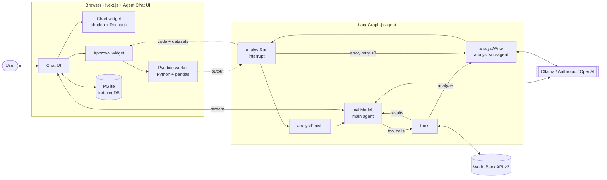

# World Bank Agent

An LLM agent that answers questions about World Bank development data
(GDP, inflation, CO2, forests, education, population, …). It finds the right
indicator, fetches the numbers, runs the analysis **as Python in your browser**
after you approve the code, and answers with interactive charts you can export.

> This project started as a test task for a job application and was reworked
> for the LPNU "LLM Agents" lab: local models via Ollama, in-browser Python
> analysis, generative-UI charts, local conversation storage and an eval harness.

## What it can do

- Answer factual questions ("What was Nigeria's population in 2023?")
- Compare countries and periods, compute growth rates, correlations, trends
- Show interactive charts (line / bar / scatter / table) with CSV, PNG and SVG export
- Keep conversations in the browser (PGlite / IndexedDB) and restore them after a server restart
- Run fully locally on a consumer GPU (Ollama + Qwen 3.5) or with Anthropic / OpenAI models

## How it works



Data flows **around** the model, not through it: fetched tables live in the
graph state, the model sees short summaries, and the browser gets the full rows
for Python and charts. Before this, one tool call could return ~200k characters
and overflow a local model's context.

### Tools

| Tool                                                      | What it does                                                                                                                                   |
| --------------------------------------------------------- | ---------------------------------------------------------------------------------------------------------------------------------------------- |
| `search_indicators(query)`                                | Fuzzy-searches ~1,500 World Development Indicators, returns the top 8 `ID \| name`                                                             |
| `get_dataset(indicatorId, countries, startYear, endYear)` | Fetches one indicator, stores the table in state, returns a summary                                                                            |
| `prepare_python(packages)`                                | Starts loading Pyodide in the browser while data is still being fetched                                                                        |
| `analyze(task, datasetIds, packages)`                     | Hands a plain-language task to the analyst sub-agent, which writes pandas code, runs it in the browser after approval and fixes its own errors |
| `show_chart(title, insight, kind, datasetIds, …)`         | Renders an interactive chart widget (generative UI) with a short explanation                                                                   |

The analyst has tested modelling helpers in its Python environment, and both agents
are prompted on when to use them (or use them when you ask, e.g. "forecast with ARIMA"):

| Helper                                        | Use it for                                                  |
| --------------------------------------------- | ----------------------------------------------------------- |
| `linear_trend(x, y)`                          | Direction and speed of a trend: slope, R², p-value          |
| `regress(data, y, xs)`                        | Does X explain Y: OLS coefficients, p-values, R²            |
| `forecast_arima(years, values, steps, order)` | Next N years of one series, with a 95% interval (chartable) |

Safety: Python runs in a Web Worker in the user's tab (no server execution), only
after approval (or "run without asking" per conversation), with an allowlist of
packages that ship with Pyodide (pandas, numpy, scipy, statsmodels, scikit-learn).

## Running it

### Requirements

- Node.js 22+ and pnpm 10 (`corepack enable` or `npm i -g pnpm`)
- One model provider: Ollama (local, free) or an Anthropic / OpenAI API key

### 1. Install

```bash
pnpm install
cp .env.example .env   # fill in what you use; empty values are skipped
```

The first provider whose variable is set wins: `ANTHROPIC_API_KEY` → `OPENAI_API_KEY` → `OLLAMA_BASE_URL`.
Optional: `ANALYST_MODEL` picks a different model for the analyst sub-agent
(e.g. `ollama/qwen2.5-coder:7b`).

### 2. Local model with Ollama (GPU)

**Option A, Docker** (needs the [NVIDIA Container Toolkit](https://docs.nvidia.com/datacenter/cloud-native/container-toolkit/latest/install-guide.html)):

```bash
docker compose up -d                       # compose.yaml in this repo
docker exec ollama ollama pull qwen3.5:9b
```

**Option B, native CLI** (uses the GPU directly when the NVIDIA driver is installed):

```bash
curl -fsSL https://ollama.com/install.sh | sh   # or your distro's package
OLLAMA_CONTEXT_LENGTH=16384 OLLAMA_FLASH_ATTENTION=1 OLLAMA_KV_CACHE_TYPE=q8_0 ollama serve
ollama pull qwen3.5:9b
```

Check that the model runs on the GPU: `ollama ps` should show `100% GPU`.
`OLLAMA_CONTEXT_LENGTH=16384` matters: the default 4k context is too small for the agent.

Models tested on an RTX 5060 Laptop (8 GB): `qwen3.5:9b` (default, 54 tok/s, reliable tool calls),
`qwen3.5:4b` (faster, weaker analysis). `deepseek-r1:8b` doesn't call tools; `gpt-oss:20b` works but
spills to CPU on 8 GB.

### 3. Start

```bash
pnpm dev
```

- Chat UI: http://localhost:3000
- LangGraph API: http://localhost:2024 (LangGraph Studio works with it too)

Port 3000 clashes with Open WebUI if you run it next to Ollama; move one of them.

## Evaluation

`eval/` holds a small harness: it sends questions through the LangGraph API and
answers the Python approvals the way the browser would (same prelude, run in a
container). It records tool calls, Python attempts and errors, charts and the answer.

Results with `qwen3.5:9b` on an RTX 5060 Laptop (8 GB), 2026-11-08:

| Run                                                                | Questions | Python runs | Failed runs | Avg time              |
| ------------------------------------------------------------------ | --------- | ----------- | ----------- | --------------------- |
| Main agent writes the code (`questions.json`)                      | 10        | 20          | 12 (60%)    | 74 s                  |
| Analyst sub-agent writes the code (`questions.json`)               | 10        | 10          | 3 (30%)     | 104 s                 |
| Model questions with graded expectations (`questions-models.json`) | 8         | 13          | 4           | 105 s, **8/8 passed** |

The analyst halves the attempts and cuts failures from 60% to 30%, at the cost of
one extra model call per analysis. The model set checks that the right helper runs
(ARIMA for forecasts, trend for "is it rising", OLS for "does X explain Y"),
that charts appear when asked, and that a too-short period is called out instead of
silently forecast. `grade.py` prints PASS/FAIL per question:

```bash
python eval/grade.py eval/questions-models.json eval/results-models.jsonl
```

Fixes the harness found on the way: invalid country codes (`UK` instead of `GB`)
crashed the API client, the agent filtered by country name while the data used
codes, and unpacking a dict result silently produced strings instead of numbers.

## Project structure

```
apps/agents      LangGraph.js agent (graph, tools, analyst sub-agent, prompts)
apps/web         Next.js chat UI (Agent Chat UI fork): chart widget, Pyodide, PGlite
packages/world-bank  Typed World Bank API client (zod, ofetch, fuse.js search)
eval/            Question sets, harness, grader, saved results
compose.yaml     Ollama with GPU
```

## Next steps

- Authentication and per-user storage
- Deploy (LangGraph Platform / Vercel)
- CI with the eval harness as a regression check

## License

[MIT](LICENSE)

### Demo (first version)

https://github.com/user-attachments/assets/bc71ce06-d60b-47e7-9ad9-4f2c1891dc40
